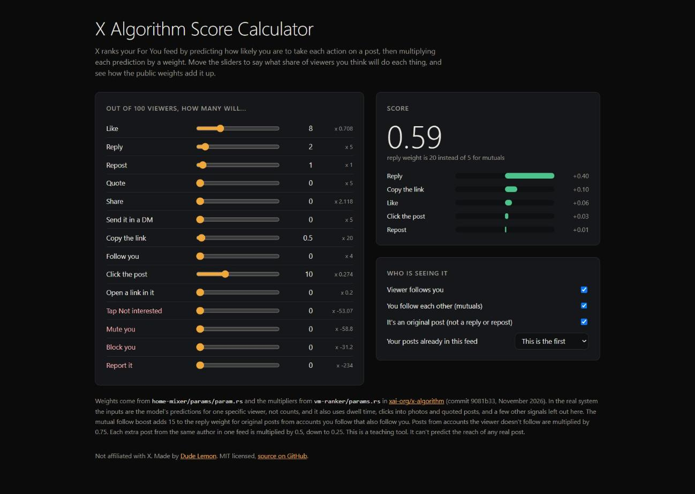

# X Algorithm Score Calculator

An interactive calculator that shows how the X **For You** ranking turns predicted engagement into a score, using the production weights published in the open source [X algorithm](https://github.com/xai-org/x-algorithm).

**Live demo:** https://dude-lemon.github.io/x-algorithm-score-calculator/



## What it does

For every post that could appear in your feed, X's ranking model (Phoenix) predicts how likely you are to take each action on it: like, reply, repost, share, mute, report and so on. Each prediction is multiplied by a weight, and the weighted values are added together. Adjustments are then applied for posts from accounts you don't follow and for repeated posts from the same author.

The calculator lets you set how many out of 100 viewers you expect to take each action, toggles the relationship between the viewer and the author, and shows the resulting score with a per-action breakdown, so you can see which actions actually move it.

## The scoring model

```
score = sum(weight_i x P(action_i))
final = score x author_diversity x out_of_network
```

| Action | Weight | Source |
|---|---:|---|
| Copy the link | 20 | [`param.rs`](https://github.com/xai-org/x-algorithm/blob/9081b33/home-mixer/params/param.rs) |
| Reply | 5 | [`param.rs`](https://github.com/xai-org/x-algorithm/blob/9081b33/home-mixer/params/param.rs) |
| Quote | 5 | [`param.rs`](https://github.com/xai-org/x-algorithm/blob/9081b33/home-mixer/params/param.rs) |
| Send in a DM | 5 | [`param.rs`](https://github.com/xai-org/x-algorithm/blob/9081b33/home-mixer/params/param.rs) |
| Follow the author | 4 | [`param.rs`](https://github.com/xai-org/x-algorithm/blob/9081b33/home-mixer/params/param.rs) |
| Share | 2.118 | [`param.rs`](https://github.com/xai-org/x-algorithm/blob/9081b33/home-mixer/params/param.rs) |
| Repost | 1 | [`param.rs`](https://github.com/xai-org/x-algorithm/blob/9081b33/home-mixer/params/param.rs) |
| Like | 0.708 | [`param.rs`](https://github.com/xai-org/x-algorithm/blob/9081b33/home-mixer/params/param.rs) |
| Click the post | 0.274 | [`param.rs`](https://github.com/xai-org/x-algorithm/blob/9081b33/home-mixer/params/param.rs) |
| Open a link | 0.2 | [`param.rs`](https://github.com/xai-org/x-algorithm/blob/9081b33/home-mixer/params/param.rs) |
| Block the author | -31.2 | [`param.rs`](https://github.com/xai-org/x-algorithm/blob/9081b33/home-mixer/params/param.rs) |
| Not interested | -53.07 | [`param.rs`](https://github.com/xai-org/x-algorithm/blob/9081b33/home-mixer/params/param.rs) |
| Mute the author | -58.8 | [`param.rs`](https://github.com/xai-org/x-algorithm/blob/9081b33/home-mixer/params/param.rs) |
| Report | -234 | [`param.rs`](https://github.com/xai-org/x-algorithm/blob/9081b33/home-mixer/params/param.rs) |

| Adjustment | Value | Source |
|---|---:|---|
| Out-of-network factor (viewer doesn't follow the author) | x 0.75 | [`vm-ranker/params.rs`](https://github.com/xai-org/x-algorithm/blob/9081b33/vm-ranker/params.rs) |
| Author diversity decay per extra post from the same author | x 0.5 | [`vm-ranker/params.rs`](https://github.com/xai-org/x-algorithm/blob/9081b33/vm-ranker/params.rs) |
| Author diversity floor | 0.25 | [`vm-ranker/params.rs`](https://github.com/xai-org/x-algorithm/blob/9081b33/vm-ranker/params.rs) |
| Mutual follow reply boost (original posts only) | +15 | [`BIDIRECTIONAL_BOOST_CHANGE.md`](https://github.com/xai-org/x-algorithm/blob/9081b33/docs/BIDIRECTIONAL_BOOST_CHANGE.md) |

Values are taken from commit [`9081b33`](https://github.com/xai-org/x-algorithm/tree/9081b33) (November 2026). The upstream repository publishes updates roughly every four weeks; weights may change.

## A note on reading the weights

The weights multiply each viewer's **predicted probability** of an action, not raw engagement counts. A report weight of -234 does not mean one report cancels hundreds of likes. As the upstream code comments explain, reports are over 1000x rarer than likes, so the weight has to be large for the prediction to affect ranking at all.

## Scope and limitations

This is an educational tool. It models the weighted sum and the two multipliers above. The production system also uses dwell time, photo and quoted-post clicks, a new-author boost, a diversity reranker and visibility filtering, which are not modelled here. It cannot predict the reach of any real post.

## Running locally

The calculator is a single static HTML file with no dependencies or build step.

```bash
git clone https://github.com/dude-lemon/x-algorithm-score-calculator.git
cd x-algorithm-score-calculator
open index.html        # macOS
start index.html       # Windows
```

## Contributing

Issues and pull requests are welcome, especially when the upstream weights change. Please include a link to the upstream commit that the new values come from.

## License

Released under the [MIT License](LICENSE).

This project is not affiliated with or endorsed by X Corp. or xAI. The weights it displays are taken from the X algorithm repository, which is licensed under Apache 2.0.

Built by [Dude Lemon](https://dudelemon.com).
